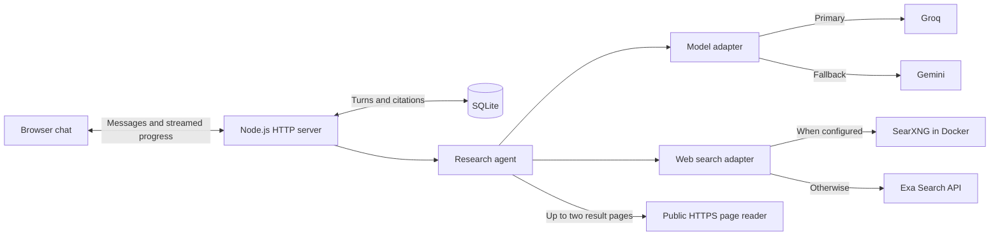
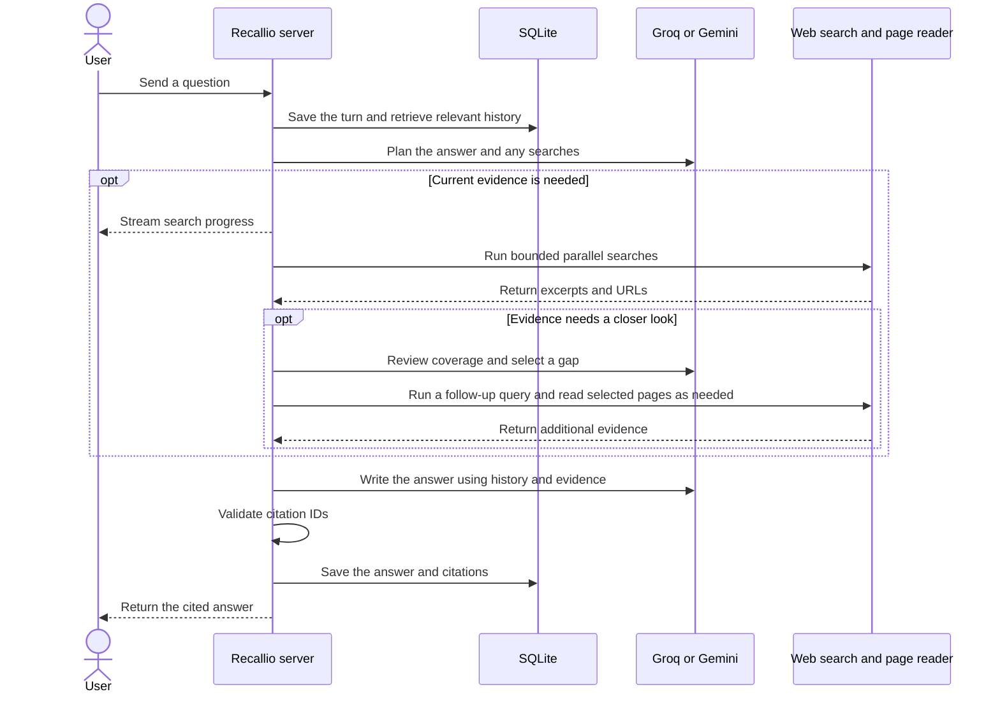

# Recallio

Recallio is a chat agent that remembers earlier conversations and checks what has changed using web search. Ask whether a vendor changed its pricing since an earlier discussion, and Recallio retrieves that conversation, checks current sources, and cites what it can verify.

[Design summary](DESIGN.md) · [Architecture decisions and roadmap](DECISIONS.md)

## Architecture

Recallio runs as one Node.js process. Docker is optional and runs SearXNG when you choose self-hosted search.





The server owns the search results. If Groq fails while writing the answer, Gemini can use the results already collected. A search timeout or a missing historical price leaves a gap that Recallio can report alongside verified findings.

## Run locally

Use Node.js 22.13 or later. From the project folder, run these commands in PowerShell.

```powershell
npm install
if (!(Test-Path .env)) { Copy-Item .env.example .env }
```

- Set `GROQ_API_KEY` for [Groq](https://console.groq.com/keys), `GEMINI_API_KEY` for [Gemini](https://aistudio.google.com/apikey), or both. Groq goes first when both are configured. Use free-tier accounts. Google may use free-tier requests to improve its products, so use non-sensitive sample chats for the demo.
- Set `EXA_API_KEY` for [Exa Starter](https://exa.ai/pricing), or set `SEARXNG_URL` for [your own SearXNG service](https://docs.searxng.org/admin/installation-docker.html). SearXNG needs JSON enabled in its search formats and takes precedence if both are configured.
- Keep your keys in `.env`, which Git ignores. Local SearXNG requires no search key. Groq, Gemini, and Exa apply the quotas and billing settings of the account that issued each key.

Run `npm run dev` and open [Recallio on localhost](http://127.0.0.1:3000) or the URL printed in the terminal. Set `PORT` if 3000 is occupied. SQLite stores chat data in `data/recallio.sqlite`. Use the same browser and URL to see earlier chats after a restart.

## Use SearXNG without a search key

If you already have a working SearXNG instance, set `SEARXNG_URL` to its base URL and run `npm run search:check`. For a fresh setup, start Docker, generate a random secret, and paste the output into `SEARXNG_SECRET` in your local `.env`.

```powershell
node -p "require('node:crypto').randomBytes(32).toString('hex')"
```

Set `SEARXNG_URL=http://127.0.0.1:43193` in the same file, then run these commands from the repo folder:

```powershell
docker compose up -d
npm run search:check
```

Compose enables JSON and publishes the service on localhost only. If port 43193 is occupied, set `SEARXNG_PORT` and change `SEARXNG_URL` to use the same port. The search check makes one request to your configured search provider without calling either model. Restart Recallio after changing its `.env`.

## Check conversation recall

To test the UI, select **Check pricing changes** on a new chat and verify that it fills the composer. Edit the text or clear it before following the steps below. After sending a message, check that the reply, any vendor statuses, and any source links are readable. Use **New chat** and the **Conversation** menu to switch between a new and saved chat. On a narrow window, check that the composer and Send button remain usable.

1. Ask “Compare the entry-level Postgres hosting plans from Neon and Supabase for a small app.”
2. Restart Recallio, choose **New chat**, and ask “What did we conclude about Postgres hosting, and has any pricing changed since?”
3. Check that the answer recalls the earlier comparison, links to evidence, and calls out any missing historical baseline.

Run `npm test` for the SQLite recovery and mocked-provider tests. These tests need no keys.

## Evaluation and hiring demo

| Command | What it runs |
| --- | --- |
| `npm run eval` | The three hiring prompts with seeded chat history, fixed synthetic search results, and your configured model. The CRM fixture includes a timeout, a preview, a shipped release, and a price change. |
| `npm run eval:web` | The same prompts with live search. Each report includes elapsed time, per-vendor search coverage, failure reasons, cited evidence, and the answer for review. |
| `npm run demo` | Starts a temporary local server, seeds a chat, restarts the server, and asks from a new chat in the same session. It verifies recall through the HTTP API with a stubbed model and removes its temporary database afterwards. |

The evaluation commands need a model key. The live web evaluation also needs SearXNG or Exa. The restart demo needs no keys. Fixture prices and releases are synthetic. Live results vary with upstream search availability and model output.

The live evaluation exits with an error if a prompt retrieves no web evidence. If search fails and returns no usable sources, Recallio can read up to two known official pricing pages for supported vendors. The report counts those separately as `directReads` and still lists the failed searches. A current pricing page can verify today's terms when it has a supporting quote. Historical status still requires dated evidence.

In PowerShell, set `$env:EVAL_RUNS = '3'` before an evaluation to repeat each prompt three times. The summary reports ranges for checklist coverage, verified outcomes, elapsed time, and model steps. It also counts fallback answers. Run `Remove-Item Env:EVAL_RUNS` to restore the default of one run.

For vendor research, Recallio builds separate pricing and release checks and shows a status for each. When both model keys are configured, Groq goes first and Gemini can continue a failed model step with the same history and evidence. Search still depends on the configured search service.

## Troubleshooting

| Symptom | Check |
| --- | --- |
| The app asks for a model key | Set `GROQ_API_KEY` or `GEMINI_API_KEY` and restart Recallio. |
| Search check reports `connection-refused` | Start Docker and run `docker compose ps`, or check the URL and port of your existing instance. |
| SearXNG search check reports `http-403` | Check that the instance allows JSON search requests. The included Compose settings enable JSON. |
| Search check reports `upstream-engines` | SearXNG responded, but returned no results and reported upstream failures. Inspect `docker compose logs --tail=50 searxng` and retry later. |
| Exa returns HTTP 402 | Check the balance for the key's Exa project or configure SearXNG. |
| An earlier conversation is missing | Reopen the same browser profile and origin, including the port you used before. |
