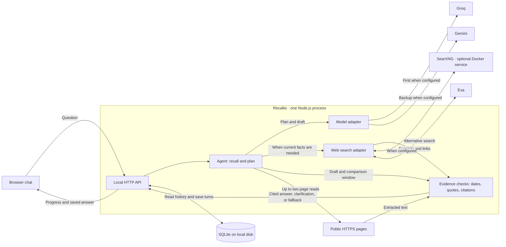
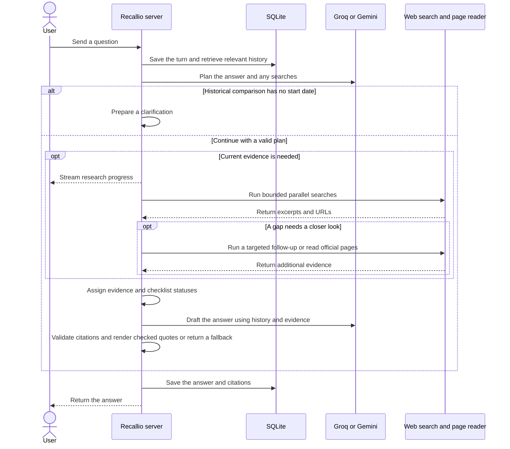

# Recallio

Recallio is a chat agent that remembers earlier conversations and checks what has changed using web search. Ask whether a vendor changed its pricing since an earlier discussion, and Recallio retrieves that conversation, checks current sources, and cites what it can verify.

[Design summary](DESIGN.md) · [Architecture decisions and roadmap](DECISIONS.md) · [Deployment plan](DEPLOYMENT.md)

## What you can do

| Feature | How it works |
| --- | --- |
| Chat and recall | Ask a question, reopen a saved conversation, or start a **New chat** and ask about an earlier one. Recallio uses relevant turns saved in the same browser session, including after a server restart. It can answer a recall question from saved history without searching the web. |
| Verify an earlier answer | Ask what you asked on a given date and whether the answer still holds. Recallio retrieves the saved question and searches for evidence about the current claim. |
| Compare vendors over time | Ask whether shortlisted vendors changed pricing or shipped releases. Recallio checks pricing and releases separately. A historical comparison needs a date from the question or a matched saved turn. If it cannot establish the date, it asks for clarification. |
| Review the evidence | Follow citation numbers to the collapsible **Sources** list. The checklist separates **Confirmed change**, **No change found in checked sources**, and **Unable to verify**. A no-change result requires evidence covering the requested period. A price quote preserves the plan and billing period. |
| Recover from failures | The chat shows progress while the server works. An interrupted saved turn can be retried. With both model keys configured, Gemini can retry a failed Groq step using the same history or evidence. If sources are missing or the answer fails validation, Recallio can show a partial result with citations and unresolved checks. |
| Customize the chat | Use the suggested prompts to fill the composer, switch between the arcade and violet themes, or open **Play Memory Run** on the welcome screen. The game loads when opened. |

## Try the workflow

After [starting Recallio locally](#run-locally), open the address printed in the terminal.

1. In a new chat, ask “Shortlist five CRM tools for a 20-person sales team.” Or start with one of the suggested questions.
2. Choose **New chat** and ask “Which tools did we shortlist, and has any changed pricing or shipped a release since that discussion?” If the reference is ambiguous, use the saved conversation's date in `YYYY-MM-DD` format after “since.”
3. Read the vendor checklist and expand **Sources**. Today's pricing page can show current terms. The historical check stays unresolved unless dated evidence establishes the change.
4. Restart Recallio and reopen the same URL in the same browser profile. Use the **Conversation** menu to reopen either chat, or ask about the earlier turn from another new chat.

## Architecture

Recallio runs as one local Node.js process. SQLite stores conversations on disk. Docker is optional and runs SearXNG when you choose self-hosted search.

### System diagram



### One question, step by step



The server allows up to 12 searches per turn, including the reserved follow-up, with up to four searches at once during the initial batch. It can also read up to two public HTTPS pages. Vendor results are ranked by official domain and relevant page titles or paths. The server assigns historical statuses and validates the evidence the models use. It can skip synthesis when a planned search retrieves no usable evidence.

## Run locally

Use Node.js 22.13 or later. From the project folder, run these commands in PowerShell.

```powershell
npm install
if (!(Test-Path .env)) { Copy-Item .env.example .env }
```

- Set `GROQ_API_KEY` for [Groq](https://console.groq.com/keys), `GEMINI_API_KEY` for [Gemini](https://aistudio.google.com/apikey), or both. Groq goes first when both are configured. Use free-tier accounts. Google may use free-tier requests to improve its products, so use non-sensitive sample chats for the demo.
- Set `EXA_API_KEY` for [Exa Starter](https://exa.ai/pricing), or set `SEARXNG_URL` for [your own SearXNG service](https://docs.searxng.org/admin/installation-docker.html). SearXNG needs JSON enabled in its search formats and takes precedence if both are configured.
- Keep your keys in `.env`, which Git ignores. Local SearXNG requires no search key. Groq, Gemini, and Exa apply the quotas and billing settings of the account that issued each key.

Run `npm run dev` and open [Recallio on localhost](http://127.0.0.1:3000) or the URL printed in the terminal. Set `PORT` if 3000 is occupied. SQLite stores chat data in `data/recallio.sqlite`. Use the same browser and URL to see earlier chats after a restart.

## Use SearXNG without a search key

If you already have a working SearXNG instance, set `SEARXNG_URL` to its base URL and run `npm run search:check`. For a fresh setup, start Docker, generate a random secret, and paste the output into `SEARXNG_SECRET` in your local `.env`.

```powershell
node -p "require('node:crypto').randomBytes(32).toString('hex')"
```

Set `SEARXNG_URL=http://127.0.0.1:43193` in the same file, then run these commands from the repo folder:

```powershell
docker compose up -d
npm run search:check
```

Compose enables JSON and publishes the service on localhost only. If port 43193 is occupied, set `SEARXNG_PORT` and change `SEARXNG_URL` to use the same port. The search check makes one request to your configured search provider without calling either model. Restart Recallio after changing its `.env`.

The included SearXNG settings enable Bing and Yahoo. An existing SearXNG instance keeps its own settings. To try this mix without replacing that instance, run the Compose service on a different port and point `SEARXNG_URL` at it.

## Data and deployment

The app binds to localhost and scopes saved chats by a browser cookie. Model calls receive your question and selected chat history. Search calls send the generated queries to the configured search provider. Use non-sensitive sample chats for the reviewer demo and keep API keys in the ignored `.env` file. See the [deployment plan](DEPLOYMENT.md) for the authentication, HTTPS, storage, and quota work needed before hosting it for others.

## Evaluation and hiring demo

| Command | What it runs |
| --- | --- |
| `npm test` | Unit and mocked-provider tests for memory, evidence, retries, and search. No API keys needed. |
| `npm run eval` | The three hiring prompts with seeded chat history, fixed synthetic search results, and your configured model. The CRM fixture includes a timeout, a preview, a shipped release, and a price change. |
| `npm run eval:web` | The three hiring scenarios with live search and the current date. Each report includes elapsed time, coverage, behavior checks, cited evidence, and the answer. |
| `npm run search:bench` | Runs ten fixed CRM queries against SearXNG without models or direct page reads. It reports official host hits in the first five results, returned engines, upstream errors, and elapsed time. |
| `npm run demo` | Starts a temporary local server, seeds a chat, restarts the server, and asks from a new chat in the same session. It verifies recall through the HTTP API with a stubbed model and removes its temporary database afterwards. |

`npm run eval` and `npm run eval:web` need a model key. The live web evaluation also needs SearXNG or Exa. The benchmark needs a SearXNG URL. The restart demo needs no keys. Fixture prices and releases are synthetic. Live results vary with upstream search availability and model output.

Both evaluations exit with an error if the plan omits a required vendor and check type, misses the saved question on dated recall, or uses the wrong historical window. A historical verdict must carry a dated quote and citation. The live evaluation uses the current date and also fails when a prompt retrieves no web evidence. The report separates official hosts, relevant page titles or paths, and verified outcomes backed by dated quotes.

When a vendor check lacks a relevant official search result, Recallio can read up to two known official vendor pages. When both types are missing and mapped, it tries one pricing page and one release index. If other search results arrived, the reserved follow-up can check another gap while those reads run. The evaluation counts direct reads separately. A release index is a reference link and cannot confirm an individual release.

The benchmark defaults to three rounds at concurrency 1, 2, and 4. To compare the default engine mix with individual engine shortcuts, set `SEARCH_BENCH_ENGINES=default,bing,yahoo`. Use `SEARCH_BENCH_RUNS` and `SEARCH_BENCH_WORKERS` to limit the comparison. In the local comparison, the previous default covered 0 of 10 CRM checks. Bing alone covered 6 of 10 across all three concurrency levels. The shipped Bing and Yahoo mix covered 9 of 10 in three consecutive runs with four workers. Freshsales releases lacked an official host hit. These counts measure source availability. Historical confirmation still requires dated evidence.

In PowerShell, set `$env:EVAL_RUNS = '3'` before an evaluation to repeat each prompt three times. The summary reports ranges for checklist coverage, verified outcomes, elapsed time, and model steps. It also counts fallback answers. Run `Remove-Item Env:EVAL_RUNS` to restore the default of one run.

## Troubleshooting

| Symptom | Check |
| --- | --- |
| The app asks for a model key | Set `GROQ_API_KEY` or `GEMINI_API_KEY` and restart Recallio. |
| Search check reports `connection-refused` | Start Docker and run `docker compose ps`, or check the URL and port of your existing instance. |
| SearXNG search check reports `http-403` | Check that the instance allows JSON search requests. The included Compose settings enable JSON. |
| Search check reports `upstream-engines` | SearXNG responded, but returned no results and reported upstream failures. Inspect `docker compose logs --tail=50 searxng` and retry later. |
| Exa returns HTTP 402 | Check the balance for the key's Exa project or configure SearXNG. |
| An earlier conversation is missing | Reopen the same browser profile and origin, including the port you used before. |
