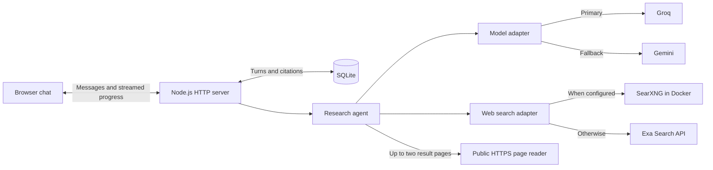
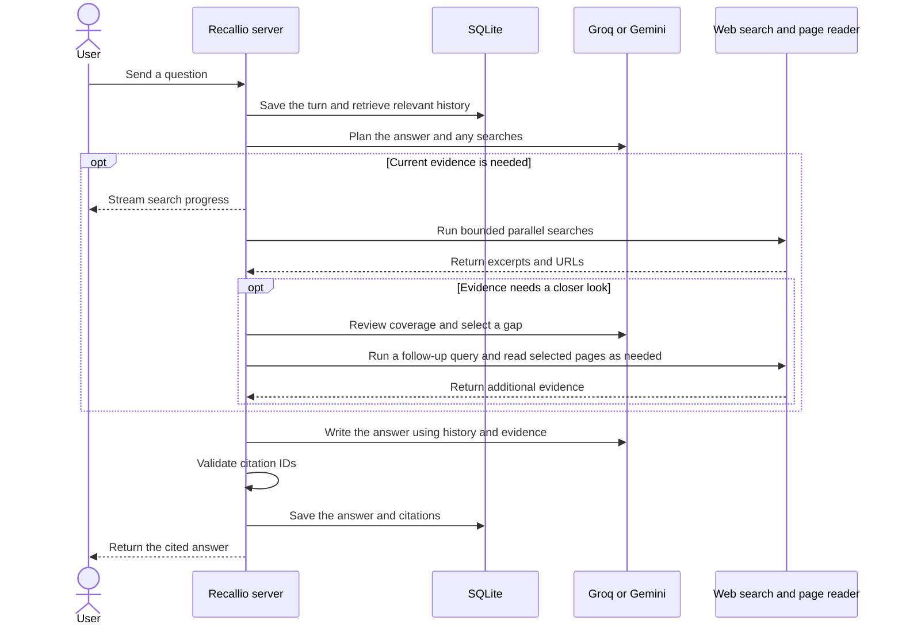

# Recallio

Recallio is a chat agent that remembers earlier conversations and checks what has changed using web search. Ask whether a vendor changed its pricing since an earlier discussion, and Recallio retrieves that conversation, checks current sources, and cites what it can verify.

[Design summary](DESIGN.md) · [Architecture decisions and roadmap](DECISIONS.md)

## Architecture

Recallio runs as one Node.js process. Docker is optional and runs SearXNG when you choose self-hosted search.





The server owns the search results. If Groq fails while writing the answer, Gemini can use the results already collected. A search timeout or a missing historical price leaves a gap that Recallio can report alongside verified findings.

## Run locally

Use Node.js 22.13 or later. From the project folder, run these commands in PowerShell.

```powershell
npm install
if (!(Test-Path .env)) { Copy-Item .env.example .env }
```

- Set `GROQ_API_KEY` for [Groq](https://console.groq.com/keys), `GEMINI_API_KEY` for [Gemini](https://aistudio.google.com/apikey), or both. Groq goes first when both are configured. Use free-tier accounts. Google may use free-tier requests to improve its products, so use non-sensitive sample chats for the demo.
- Set `EXA_API_KEY` for [Exa Starter](https://exa.ai/pricing), or set `SEARXNG_URL` for [your own SearXNG service](https://docs.searxng.org/admin/installation-docker.html). SearXNG needs JSON enabled in its search formats and takes precedence if both are configured.
- Keep your keys in `.env`, which Git ignores. Local SearXNG requires no search key. Groq, Gemini, and Exa apply the quotas and billing settings of the account that issued each key.

Run `npm run dev` and open [Recallio on localhost](http://127.0.0.1:3000) or the URL printed in the terminal. Set `PORT` if 3000 is occupied. SQLite stores chat data in `data/recallio.sqlite`. Use the same browser and URL to see earlier chats after a restart.

## Use SearXNG without a search key

With Docker running, create a folder called `searxng-config` outside the repository. Save this as `settings.yml` inside it and replace the placeholder with a random secret.

```yaml
use_default_settings: true
server:
  secret_key: "replace-with-a-random-secret"
  limiter: false
search:
  formats:
    - html
    - json
```

From the folder containing `searxng-config`, run the following in PowerShell. The port is bound to this machine only.

```powershell
$config = (Resolve-Path ./searxng-config).Path
docker run -d --name recallio-searxng --restart unless-stopped -p 127.0.0.1:43193:8080 --mount "type=bind,source=$config,target=/etc/searxng" searxng/searxng:latest
```

Open [a test JSON search](http://127.0.0.1:43193/search?q=Supabase+pricing&format=json), then set `SEARXNG_URL=http://127.0.0.1:43193` in Recallio's `.env` and restart Recallio.

## Check conversation recall

1. Ask “Compare the entry-level Postgres hosting plans from Neon and Supabase for a small app.”
2. Restart Recallio, choose **New chat**, and ask “What did we conclude about Postgres hosting, and has any pricing changed since?”
3. Check that the answer recalls the earlier comparison, links to evidence, and calls out any missing historical baseline.

Run `npm test` for the SQLite recovery and mocked-provider tests. These tests need no keys.

## Troubleshooting

| Symptom | Check |
| --- | --- |
| The app asks for a model key | Set `GROQ_API_KEY` or `GEMINI_API_KEY` and restart Recallio. |
| SearXNG requests fail | Keep Docker running and open the test JSON URL above. Check the port mapping and JSON format setting. |
| Exa returns HTTP 402 | Check the balance for the key's Exa project or configure SearXNG. |
| An earlier conversation is missing | Reopen the same browser profile and origin, including the port you used before. |
